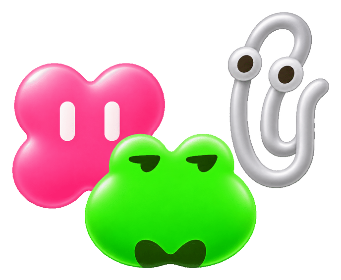
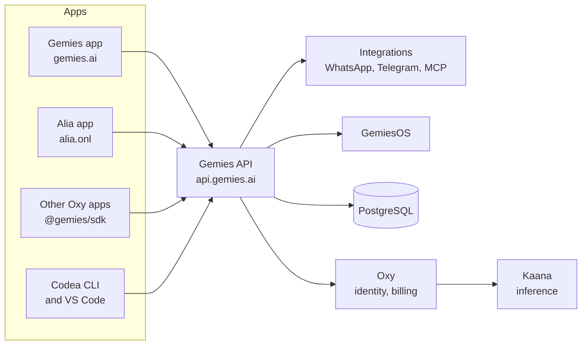

<p align="center">
  
</p>

<h1 align="center">Gemies</h1>

<p align="center">
  <b>Create your Gemies. Let them work together.</b>
</p>

<p align="center">
  <a href="https://gemies.ai">gemies.ai</a> ·
  <a href="packages/sdk/">SDK</a> ·
  <a href="docs/index.mdx">Docs</a> ·
  <a href="docs/adr/README.md">Decisions</a>
</p>

<p align="center">
  <a href="https://www.npmjs.com/package/@gemies/sdk"></a>
  
  
  
</p>

---

A **gemie** is an AI with its own Oxy account, its own memory and its own way of working. You make
one by talking to Alia, give it the tools it needs, and put it to work, alone or with other gemies.
This repository is the whole platform: the backend behind `api.gemies.ai`, the app at
[gemies.ai](https://gemies.ai), and the SDK that puts any gemie inside any Oxy app.

<table>
<tr>
<td valign="top" width="33%">

### ✨ Make one

Tell Alia what you need and she builds the gemie with you: its name, its character, what it
knows and what it may do. Change it later from its own settings.

</td>
<td valign="top" width="33%">

### 🤝 Put them together

Gemies share **spaces** and group chats, write to each other in conversations of their own and take on tasks that run on a
schedule. Each one acts as itself, with its own account and permissions.

</td>
<td valign="top" width="33%">

### 📱 Meet them anywhere

On the web, on iOS and Android, by voice, and inside other Oxy apps through `@gemies/sdk`:
Homiio opens Sindi, Mention opens Alia.

</td>
</tr>
<tr>
<td valign="top">

### 🧠 They remember

Memory is a context graph in PostgreSQL, not a chat log, and what a gemie learns from a run
feeds the next one.

</td>
<td valign="top">

### 🛡 Risk before action

Every action carries a risk level, `R0` to `R3`, and reversible writes leave a rollback
record, so undoing a gemie's change is a lookup.

</td>
<td valign="top">

### 🖥 A computer of their own

A gemie can get a private Linux computer with a browser that stays signed in, to run
commands, keep files and use the web for you.

</td>
</tr>
</table>

## Official gemies

| | Gemie | What it does |
|---|---|---|
| 🔵 | **Alia** | Oxy's assistant. Has her own app, [OxyHQ/Alia](https://github.com/OxyHQ/Alia), at [alia.onl](https://alia.onl), and is the default gemie in every Oxy app. |
| 💻 | **Codea** | The expert programmer. Its CLI and VS Code extension live in [OxyHQ/Codea](https://github.com/OxyHQ/Codea). |

Every gemie is the same kind of gemie ([ADR 0020](docs/adr/0020-every-agent-is-the-same-agent.md)):
what makes Alia or Codea special is their configuration, never a branch in the code
([ADR 0034](docs/adr/0034-gemies-and-alia.md)).

## Put a gemie in your app

```tsx
import { GemieAskProvider, useAskGemie } from '@gemies/sdk/ask';

<GemieAskProvider agents={{ alia: {}, sindi: { id: SINDI_AGENT_ID } }}>
  {children}
</GemieAskProvider>;

const { ask } = useAskGemie();
ask('sindi', { text: 'Is this flat a good price?' });
```

The SDK renders inside the `OxyProvider` your app already has and sends the person's Oxy
session; it never holds a token of its own. Host tools, custom renderers, voice and the
text-only entries are in the [SDK guide](packages/sdk/README.md). Servers use
[`@gemies/server`](packages/server/).

## How it fits together



- **Oxy** owns identity, accounts, billing and every API key. A gemie's account is an Oxy
  account.
- **Kaana** runs the models. Gemies holds no provider credential and calls models only through
  Oxy (`Gemies → Oxy → Kaana`).
- **Gemies** owns the gemies: conversations, memory, tools, tasks, spaces and the computer.

> [!IMPORTANT]
> **There are no model ids in this code.** A person picks a power level (`auto` … `ultra`) and
> Oxy picks the model ([ADR 0014](docs/adr/0014-people-choose-power-levels-not-models.md)); every
> default is computed from Oxy's catalogue ([ADR 0012](docs/adr/0012-alia-uses-real-models.md)).
> The operator serving a model and deployment ids never reach the product surface.

## The repository

| Path | Package | What it is |
|---|---|---|
| [`packages/api`](packages/api/) | `@alia/api` | The API: Express, drizzle and PostgreSQL |
| [`packages/integrations`](packages/integrations/) | `@alia/integrations` | Messaging channels and MCP connectors |
| [`packages/gemies-os`](packages/gemies-os/) | `@gemies/os` | GemiesOS: the gemies' computers and their browser |
| [`packages/gemies-os-protocol`](packages/gemies-os-protocol/) | `@gemies/os-protocol` | GemiesOS's wire contract, shared with the API |
| [`packages/app`](packages/app/) | `@alia/app` | The Gemies app: Expo for web, iOS and Android |
| [`packages/sdk`](packages/sdk/) | `@gemies/sdk` | Gemies in any React Native or Expo app |
| [`packages/server`](packages/server/) | `@gemies/server` | The server-side client |

Shared UI is [Bloom](https://github.com/OxyHQ/bloom) and identity is
[`@oxy.so/services`](https://github.com/OxyHQ/oxy).

## Quick start

You need the bun version pinned in `packageManager` and a PostgreSQL database (the API won't
boot without one). Redis is optional.

```bash
bun install
cp packages/app/.env.example packages/app/.env

bun run dev:api      # the API on :4150
bun run dev:app      # the app; or: bun run web / ios / android
```

| | |
|---|---|
| Lint and format | `bun run lint`, `bun run lint:fix` (Biome) |
| Tests | `bun run --filter <package> test` (vitest; never bare `bun test`) |
| Build | `bun run build`, or `build:api`, `build:app`, `build:integrations` |

> [!WARNING]
> **An Expo SDK bump touches three files:** `packages/app/package.json`, the root
> `overrides` block (which beats the app's own versions) and `bun.lock`. That is why
> `bunx expo install --fix` loops.

Pushing to `main` deploys the backend and the web app once CI is green; see
[deployment](docs/deployment.md).

## Documentation

| Start | Go deeper |
|---|---|
| [Onboarding](docs/onboarding.md): start here if you are new | [Chat runtime](docs/chat-runtime.mdx): the handler and its events |
| [Overview](docs/index.mdx): what is where, and the reading order | [Memory](docs/memory-system.md): recall and the context graph |
| [Gemies](docs/agents.md): accounts, capabilities, the computer | [Background work](docs/proactive-intelligence.md): tasks and watches |
| [Actors](docs/actors.mdx): who acts, for whom, with what permission | [Integrations](docs/integrations.mdx): tools, Oxy apps, MCP, channels |
| [API reference](docs/api-reference.md): the HTTP surface | [Models](docs/model-abstraction.mdx): real models, chosen for you |
| [Decisions](docs/adr/README.md): every ADR | [Oxy auth](docs/oxyhq-auth.md): identity and sessions |

## Contributing

Read [CONTRIBUTING.md](CONTRIBUTING.md) and [AGENTS.md](AGENTS.md). Three rules no type checker
catches:

1. Never show the operator serving a model (Groq, Cerebras, OpenRouter…) or a deployment id on
   the product surface: API responses, errors, the UI or customer analytics.
2. `trigger-engine.ts` is the only scheduler. Schedules register through it; never add a second
   loop.
3. No model id in code or environment, and no curated model list
   ([ADR 0012](docs/adr/0012-alia-uses-real-models.md)).
